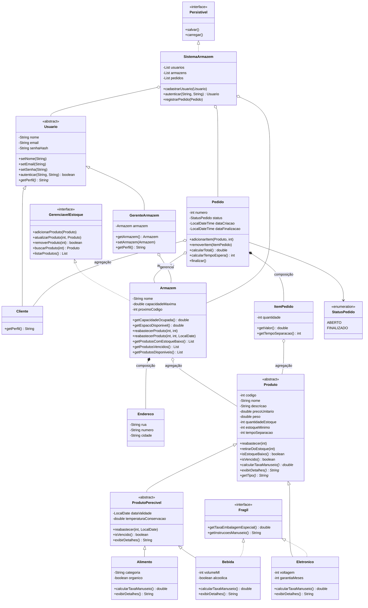

# Diagrama de classes — Projeto Armazém

O GitHub renderiza o bloco Mermaid abaixo automaticamente. Para exportar como imagem (PNG/SVG),
cole o conteúdo em <https://mermaid.live>.

Legenda: `*--` composição (o contido não existe sem o todo), `o--` agregação (objetos independentes),
`<|--` herança, `<|..` implementação de interface, `*` após o método indica método abstrato.
